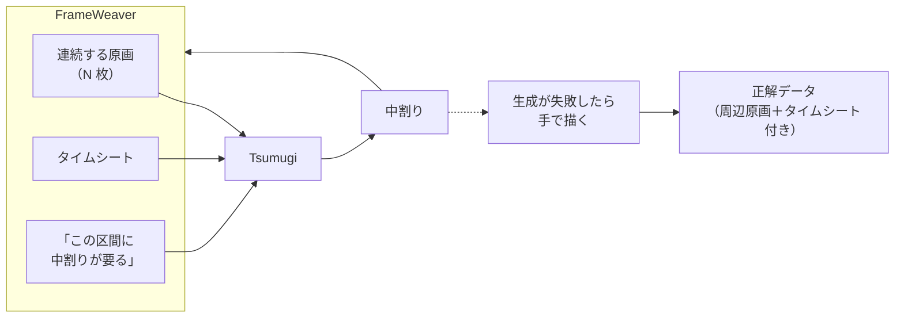
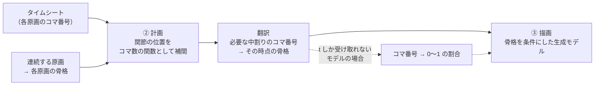
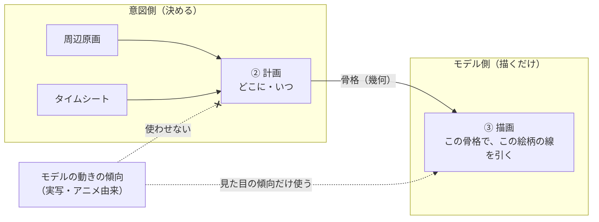
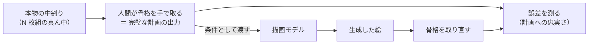
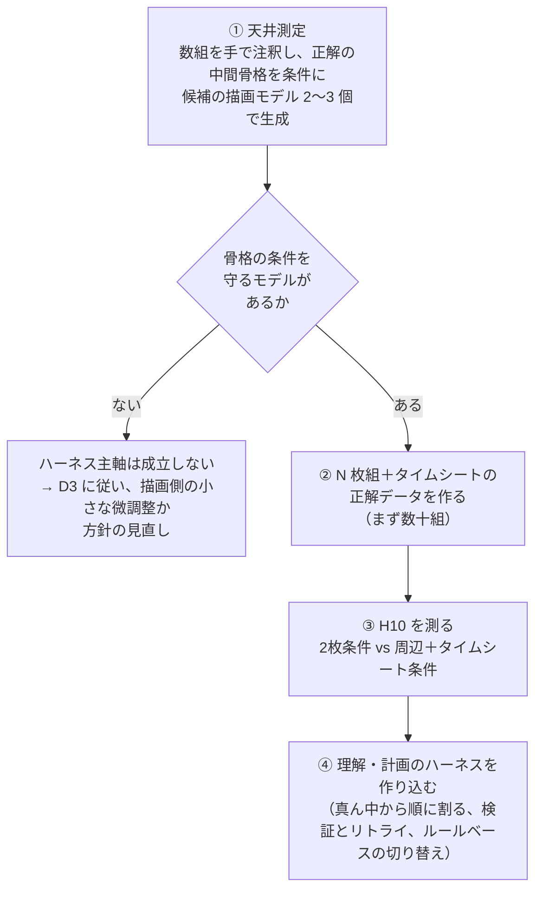
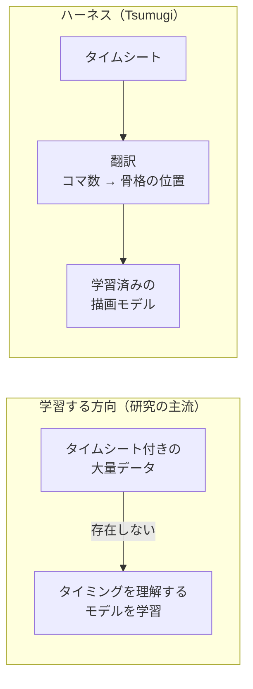

# Tsumugi 方針ドキュメント

2026-10-31 時点の決定事項。背景と調査の詳細は [`tsumugi-notes.md`](./tsumugi-notes.md) にあり、このドキュメントはそこから **何を決めたか** だけを切り出したもの。方針が変わったらこのファイルを更新し、末尾の変更履歴に残す。

> **一言で**
> 学習済みモデルを組み合わせる **ハーネス設計** で中割り生成を改善する。
> タスクは「2枚の原画の補間」ではなく **「タイムシート付きの連続原画の穴埋め」** と定義し、FrameWeaver を周辺原画とタイムシートの供給元にする。
> タイムシートは時間軸を持ち込むためのもので、関節の位置を **実時間（コマ数）の関数** として扱い、問題を「補間」から「軌道の推定」に変える。
> ただし「ハーネスでどこまで行けるか」は信念ではなく、**最初に天井を測って数字で確かめる**。

* * *

## 目次

1. [決定事項](#1-決定事項)
2. [タスクの定義](#2-タスクの定義)
3. [理解・計画・描画の3段階への影響](#3-理解計画描画の3段階への影響)
4. [評価の変更](#4-評価の変更)
5. [最初にやること](#5-最初にやること)
6. [FrameWeaver との境界](#6-frameweaver-との境界)
7. [既存研究との位置付け：タイムシートを入力に取る手法はあるか](#7-既存研究との位置付けタイムシートを入力に取る手法はあるか)
8. [未決事項](#8-未決事項)
9. [変更履歴](#9-変更履歴)

* * *

## 1. 決定事項

| # | 決定 | 理由 | 詳細 |
|---|------|------|------|
| **D1** | 研究の主軸は **ハーネスで補う方向**。新しいモデルの学習やファインチューニングは、天井に当たってから検討する | 学習用 GPU もデータもない環境（RTX 3080 / VRAM 10GB）で始められる。学術研究はモデルを学習する方向が主流なので、「既存モデル＋ハーネスでどこまで行けるか」は競合の少ない切り口 | notes 11章 |
| **D2** | **天井の測定を最初にやる**。ハーネスに時間を使う前に、「計画に正解を与えたときに描画モデルがどこまで条件を守れるか」を数組の手動注釈で測る。条件には **つめの効いた極端な骨格** も含める（7章） | ハーネスが決められるのは「どの部品を使うか・いつやり直すか」であって、どの部品もできないことは埋められない。一番難しい「2枚の間でパーツや線の対応を取る」はどの部品も弱いので、天井を測る前に組み合わせに時間を溶かすのが最大のリスク | notes 13章「理想の入力を与えて上限を測る」 |
| **D3** | 「ハーネスかファインチューニングか」の二択はしない。**部品単位で「買うか作るか」を決める**。測定で弱いと分かった小さな部品（例：アニメ絵向けのポーズ推定）は、少量データで微調整する選択肢を残す | 生成モデル全体の学習は無理でも、小さな部品の微調整は RTX 3080 で現実的。方針を変えずに学習の利点を取り込める | — |
| **D4** | タスクを **「タイムシート付きの連続原画の穴埋め」** と定義する。入力は2枚ではなく、前後の原画を含む N 枚とタイムシート。**関節の位置は実時間（コマ数）の関数として扱う** | 周辺の原画があれば、関節の位置を複数点通る曲線で結べて弧と緩急が原画から推定できる。原画2で隠れている足が原画1と3で見えていれば「存在して、ここからここへ動いている」と分かる。対応付けも2枚のマッチングではなく N 枚の追跡になる。タイムシートがあると、各原画が何コマ目にあるかが決まり、位置だけでなく速度・加速度を持つ動きとして扱える | 2章 |
| **D5** | **FrameWeaver を周辺原画とタイムシートの供給元にする**。「ここに中割りが足りない」と指定した瞬間に、どの原画の間に・何枚・どのタイミングで、という生成の仕様が揃う形にする | notes で1位に置いた「情報を足す」の最大の弱点は注釈の手間だった。FrameWeaver から出てくるなら手間がほぼゼロになる。方針の変更ではなく、情報を足すコストを製品側に吸収させる設計 | 6章 |
| **D9** | **時間の扱い方**：計画の段階ではコマ数（実時間）で扱い、描画モデルには時間ではなく **その時点の骨格（幾何）** に翻訳して渡す。物理的な事前知識（等速、滑らかな加速）は原画の間を埋める初期値にとどめ、**タイムシートに書かれた間隔をアニメーターの意図として優先する** | 描画モデルが受け取る t=0.3 は、等速に近い動画で学んだモデルにとって「3割の位置」でしかなく、つめとは一致しない。計画でスプラインをコマ数で引き、必要なコマの骨格を求めて条件として渡せば、タイミングは骨格の位置に織り込まれ、モデルは時間を理解する必要がない。時間軸を入れると物理の前提を持ち込みたくなるが、アニメーターはつめや誇張で意図的にそれを破る。1コマ打ち・2コマ打ち・3コマ打ちで「中割り3枚」の実時間は変わるので、時間はコマ数で持たないと緩急が崩れる | 2章「時間軸」、7章 |
| **D10** | タイムシートは **学習させるものではなく、翻訳するもの**。タイムシートを入力に取る学習済みモデルは存在しないが、ハーネスなら学習データなしで使える。データが要るのは評価（タイミング付きの正解データ、数十組）と、天井の測定だけ | タイムシート付きの中割りデータセットは研究の側にない。だから学習する方向では誰も手を出していない。翻訳なら必要ない。この空白にデータなしで入れる唯一の方法がハーネス | 7章 |
| **D11** | **生成モデルに動きを決めさせない。決めるのは意図側**。動き（どこに、いつ）は計画の段階で周辺原画とタイムシートから決め、描画モデルには「この骨格でこの絵柄の線を引く」ことだけを頼む。軌道をモデルに自動推定させるモード（Framer のオートパイロットなど）は使わない | 動画で学習したモデルが持つのは物理法則ではなく「学習データの動きの傾向」。実写で学んだモデルは実写の動きを持ち込む。アニメは物理を破るので、モデルに動きを決めさせるとその傾向が漏れ込む。骨格の条件が強く効くほどモデルの動きの傾向は使われなくなり、残る仕事は見た目の傾向（線の質、形の細部）だけになり、それは実写由来でも害が少ない | 3章「生成モデルの動きの傾向」 |
| **D6** | 正解データは3枚組ではなく **N 枚の連続原画から真ん中を隠す形** にする。同じデータで「2枚だけ渡す条件」と「周辺＋タイムシートも渡す条件」を比較できるようにする | D4 の効果を手動注釈なしで測れる。仮説 **H10** として追加 | 4章 |
| **D7** | 生成が失敗したときに手で描いた中割りを、タイムシートと周辺原画付きで **正解データとして蓄積する** | 研究の世界は合成データで学習している。手描きで文脈付きのデータが自然に溜まる仕組みは個人では珍しい資産で、天井に当たってファインチューニングを検討する段階で効く | 6章 |
| **D8** | 成果の出口は **OSS・記事・実用ツール**。論文は狙わない | ハーネス主軸は論文としては不利で、OSS・記事・実用ツールとしては有利。出口を決めておかないと、評価ハーネスにどこまで厳密さを求めるかが決まらない | — |

D4 と D5 は独立した決定ではなく **セット**。原画2枚でタイムシートが「間に3枚、等間隔」なら、時間軸は 0.25・0.5・0.75 という割合に戻るだけで何も増えない。間隔が不均一なとき、あるいは3枚以上の原画で速度が決まるときに、初めて時間が意味を持つ。

* * *

## 2. タスクの定義

### 変更前と変更後

| | 変更前（notes の「最初の一歩」） | 変更後 |
|---|---|---|
| 入力 | 塗り済みの原画 **2枚** | 塗り済みの原画 **N 枚**（前後の原画を含む）＋ **タイムシート** |
| 出力 | 時点 0.5 の1枚 | タイムシートで指定された位置の中割り（枚数・時点は機械的に決まる） |
| 生成の起点 | 2枚を渡して「間を作って」 | FrameWeaver で「この区間に中割りが要る」と指定 |
| 情報の出どころ | 手で注釈 | FrameWeaver が出力する |

### 情報の量（notes 12章の L0〜L4）との対応

| 条件 | 与える入力 | 変更後の位置付け |
|------|-----------|------------------|
| L0 | 原画2枚だけ | 基準（RIFE などとの比較用） |
| L1 | ＋テキストの意図 | 任意 |
| L2 | ＋骨格 | ハーネスが原画から推定する |
| **L3** | **＋ブレイクダウンの原画** | **周辺の原画として、FrameWeaver から既定で供給される** |
| **L4** | **＋つめの指示や軌道線** | **タイムシートとして、FrameWeaver から既定で供給される** |

つまり、L3・L4 を **最初から既定の入力にする** のが D4・D5 の中身。2枚だけの補間は L0 として残り、特別な条件ではなく比較の基準になる。

### 時間軸

RIFE などに渡す時点 0〜1 は **位置の割合であって時間ではない**。原画 A と B の間が3コマでも12コマでも、モデルは等速を暗黙の前提に中間の位置を作るだけ。この枠組みでは、動きは「2つの姿勢」しか持たず、速度も加速度も存在しない。「ここで速くなって、ここで止まる」を表現する場所がそもそもない。

タイムシートで各原画が何コマ目にあるかが決まると、関節の位置を **時間の関数** として扱える。周辺の原画が5枚あっても、タイミングがなければ5つの姿勢が並んでいるだけで、タイミングがあって初めて **軌道** になる。

| できること | 時間軸がないと |
|---|---|
| 原画3での速度を、原画2と4の位置と **時間差** から決める | 隣の原画との位置差しか分からず、速度の概念がない |
| つめ（緩急）を、原画の間隔の不均一さとして自然に表現する | 「原画 A 寄りに 1/3」を手で指示するしかない |
| 歩きの接地フレームで足が止まる、といった時間に依存する制約を書く | 書けない |
| 生成した一連の中割りのなめらかさ（ジッター、速度の不連続）を評価する | 1枚ずつの正解との距離しか測れない |

時間軸は **計画の段階に住み、描画の段階には「その時点の骨格」として降りていく**（D9）。notes 8章の「決まった書式の記号は翻訳で渡せる」の延長で、翻訳の直前までは実時間で持つ。描画モデルが骨格を条件に取れるなら、0〜1 の割合 t はほぼ意味を持たなくなる。割合 t しか受け取れないモデル（RIFE など）に渡す場合だけ、コマ番号を t に翻訳する。

### この定義で変わらないこと

- 基本方針（notes 10章）：ピクセルではなく線・面・塊・構造の単位で捉え、各単位にコンテキストを載せる
- 3段階のフロー（notes 8章）：理解 → 計画 → 描画
- 「面」から始める進め方（notes 10.10）：塗り済みの原画で面と色指定の意味がほぼ無料で手に入る

* * *

## 3. 理解・計画・描画の3段階への影響

周辺の原画とタイムシートが効くのは主に **理解と計画** で、描画は別問題として残る。ここを混同しないこと。

| 段階 | 周辺原画・タイムシートで変わること | 変わらないこと |
|------|----------------------------------|----------------|
| **① 理解** | パーツの対応付けが「2枚のマッチング」から「N 枚の追跡」になる。見た目が似た線の取り違えが減る。隠れているパーツも、前後の原画で見えていれば存在と行き先が分かる | ラフな原画や手描き特有の揺れへの対応は依然として難しい |
| **② 計画** | 関節の位置を **コマ数の関数** として複数点通る曲線で結べるので、弧と緩急（速度・加速度）が原画から推定できる。タイムシートから生成すべき時点が機械的に決まる（notes 8章の「翻訳」）。接地で足が止まる、といった時間に依存する制約を書ける | 物理の事前知識はあくまで初期値。タイムシートの間隔が意図として優先される（D9） |
| **③ 描画** | ほぼ変わらない。周辺の原画やタイムシートを直接受け取れる生成モデルは少ない（RIFE は2枚のみ、Framer は開始・終了＋軌道が基本。多フレームの文脈を受け取れるのは動画生成系に限られる） | **骨格などの条件を生成モデルがどこまで守れるか**。これが天井であり、D2 で最初に測る対象 |

精度向上は「骨格や軌道をより良く推定できる」経路で現れる。最後に線を引くモデルがそれを守れるかは、入力を増やしても解決しない。

### 期待値について

FrameWeaver で「ここに中割りが要る」と分かる場所は、定義上、動きが大きくて飛んで見える区間。周辺の文脈が最も役立つ場所でもあるが、楽になるわけではない。**一番必要な中割りは、一番難しい隙間にある**。

### 生成モデルの「動きの傾向」との付き合い方（D11）

**疑問**：画像・動画の生成モデルは実写動画から物理法則を推測しているのではないか。アニメは物理法則を必要とせず、むしろ物理を考えない世界が大切なので、そういうモデルは役に立たないのではないか。

**答え**：半分正しく、半分は言い換えが要る。

| 論点 | 整理 |
|------|------|
| モデルは物理法則を推測しているか | していない。持っているのは「学習データの中で、こういう絵の次にはこういう絵が来やすい」という **統計的な傾向**。実写で学べば結果的に重力や慣性に似た振る舞いになるが、法則として理解してはいない（貫通や手の本数の変化を平気で出す） |
| では何が問題か | 「物理を仮定していること」ではなく、**「学習データの動きの傾向を、それが何であれ持ち込むこと」**。実写で学んだモデルは実写の動きを、アニメで学んだモデル（ToonCrafter）はアニメの動きの傾向を持ち込む。RIFE がアニメで苦しむ理由の一つは、実写の滑らかな動きで学んだモデルに3コマ打ちの飛びを見せているから |
| アニメは無法則か | 違う。物理は破るが、予備動作・フォロースルー・弧・つめ・スミアといった **その世界なりの一貫性** があり、崩れると違和感が出る。物理法則ではないが **学習可能な規則性**。ただしデータが実写に比べて圧倒的に少なく、止め絵や3コマ打ちを含むので補間の学習データとして扱いにくい |
| Tsumugi の設計との関係 | 3段階に分けた理由そのもの。**動き（どこに、いつ）は計画の段階で意図から決め、描画モデルには「この骨格でこの絵柄の線を引く」ことだけを頼む**。骨格の条件が強く効くほどモデルの動きの傾向は使われなくなり、残る仕事は見た目の傾向（線の質、形の細部）だけ。見た目の傾向は実写由来でも害が少ない |
| 避けるべきこと | **モデルに動きを決めさせるモード**。Framer のオートパイロット（軌道をモデルが自動推定する）は便利に見えるが、そこで学習データ由来の動きの傾向が入る。軌道は常に計画の段階から渡し、モデルに推定させない |
| 残る問題 | 天井。骨格を渡しても自分の動きの傾向に引きずられて条件を無視するなら、設計は成立しない。この疑問を測定に翻訳すると **「物理的にありえないポーズや間隔を指示したとき、モデルは指示に従うか、自分の傾向に戻るか」** の一点になる。D2 の天井測定（5章）で、つめの効いた極端な骨格を条件に含めるのはこのため |

* * *

## 4. 評価の変更

### 正解データ

| | 変更前 | 変更後 |
|---|---|---|
| 形 | 3枚組（真ん中を隠す） | **N 枚の連続原画＋タイムシート**（真ん中を隠す） |
| 2枚条件との比較 | 別のデータが必要 | 同じデータから「2枚だけ渡す」「周辺＋タイムシートも渡す」の両条件を作れる |
| 出どころ | 公開データセット、自分で描いた作画 | 同左に加えて、FrameWeaver での手直し（D7） |

3枚組は N=3 の特殊ケースなので、既存の計画を捨てるわけではない。

### 追加する指標：一連の中割りの時間的な連続性

notes 12章の採点は1枚の中割りと正解の比較が中心だが、中割りの良し悪しは本来ラインテストで動かして判断するもので、1枚の絵の正しさではなく **動きの連続性** にある。時間軸が入ったので、この評価軸を足す。

| 指標 | 中身 | 正解データ |
|------|------|-----------|
| 関節の速度の連続性 | 生成した一連の中割りから骨格を取り、関節の速度（コマ間の位置差）が不自然に跳ねていないか | なし（生成結果だけで測れる） |
| 本物との速度の一致 | 各コマの関節の速度を、本物の一連の中割りの速度と比べる | 本物の中割り（N 枚組） |
| タイムシートへの忠実さ | 生成した中割りの位置が、タイムシートの間隔（つめ）どおりの時点になっているか | タイムシート |

「関節の速度の連続性」は正解データなしで測れるので、ハーネスの検証（notes 11章のリトライ判定）にも使える。

### 追加する仮説

notes 13章の H0〜H9 に加える。

| # | 仮説 | 比べる条件 |
|---|------|-----------|
| **H10** | 周辺の原画とタイムシートを入力に含めると、2枚だけより中割りが良くなる | 同じ N 枚組で、「隣接する2枚だけ渡す」と「周辺の原画＋タイムシートも渡す」。描画モデルは固定し、理解・計画の段階だけに追加情報を使う |

H10 の設計上の注意：描画モデルが周辺情報を受け取れないなら、差が出るのは理解・計画の成果物（骨格、軌道、前後関係）の精度と、それを条件にした最終結果。notes 13章の「段階ごとに採点する」をそのまま使い、**どの段階で差が出たか** を分けて記録する。

### 最初に答えを出す仮説

H0〜H10 のうち、最初の数ヶ月で本当に数字を出すのは次の2つに絞る。

| 優先 | 仮説 | 理由 |
|------|------|------|
| 1 | **天井測定**（H8 の前提。「計画に正解を与えた場合の描画の結果」） | D2。これが低ければ他の仮説の意味が変わる |
| 2 | **H10** | D4・D5 の方針そのものの検証。正解データが安く作れる |

H9（階層を上げるほど良くなる）は基本方針の検証として重要だが、面の対応だけでは解けない前後関係（H6 の領域）と混ざりやすい。切り分けるなら、前後関係の入れ替わりがない区間から始める。

* * *

## 5. 最初にやること

順番が大事。ハーネスを作り込む前に天井を測る。

### 天井測定とは何か、なぜ最初にやるか

**天井**：理解と計画をどれだけ良くしても、最終的な絵の質は「描画モデルが、渡された骨格をどこまで守って描けるか」で頭打ちになる。この上限のこと。

**目的**：**次の数ヶ月をどこに投資するかを決める**。天井が低い（完璧な骨格を渡しても描画モデルが条件を無視して自分の傾向で描く）なら、理解・計画に何ヶ月かけても最終結果は良くならず、やるべきことはハーネスの改善ではなく描画モデルの選び直しか微調整になる。天井が高いなら、「今の結果が悪いのは理解・計画のせいだ」と確信してハーネスに集中できる。ハーネスを作った後に測ると、この判断に使えた時間がすでに消えている。

「構造にコンテキストを載せてモデルに伝える」という研究の中心は **伝える側** の話。伝えた先のモデルが受け取れなければ、どれだけ良いコンテキストを載せても届かない。天井測定は、**今の描画モデルが構造をどこまで受け取れるかを、伝える側を作る前に確かめる** 作業で、研究の前提条件の確認にあたる。

**測り方**：「ハーネスがない状態」で測るのではなく、**ハーネスの仕事（理解・計画）を人間が完璧に代行した状態** で測る。

正解の絵との比較ではなく、**指示を守ったかどうか** だけを見る（notes 13章の「計画への忠実さ」）。この測り方はハーネスの出来に一切依存しない。理解の精度もポーズ推定の良し悪しも関係なく、「描画モデルという部品が単体で何ができるか」だけが出る。

**結果の読み方**：

| 結果 | 意味 | 次の行動 |
|------|------|----------|
| 完璧な骨格を渡せば守って描ける | 天井が高い。悪い結果はすべて理解・計画の責任 | ハーネスに集中する。方針どおり |
| 普通の骨格は守るが、つめの効いた極端な骨格やありえないポーズは無視して自分の傾向に戻る | 天井は条件つき。アニメらしい動きほど守られない | モデルの選び直し、または描画側だけの小さな微調整を検討（D3）。**どの範囲なら守るかをハーネスの適応ルールにする**（この範囲を超えたら別の手法に切り替える、人にブレイクダウンを求める） |
| 守らない | 天井が低い。ハーネス主軸は成立しない | 描画モデルの選定からやり直す。この時点でハーネスに時間を使っていないのが救い |

二つ目の結果が一番ありそうで、一番有益でもある。「どこまでなら守るか」の境界が分かれば、それ自体がハーネスの適応ルールになる。

**一度きりではない**：描画モデルを変えたとき、新しい条件付けの方法を試すときは、毎回同じ測定をやり直す。最初の一回はハーネスの前にやるが、その後は **「描画モデルの単体テスト」として評価ハーネスの中に常設する**。tcg-buylist-eval で言えば、LLM 単体のベンチマークを先に取るのと同じ位置付け。

### 進め方

| 段階 | 中身 | 必要なもの | 目安 |
|------|------|-----------|------|
| ① 天井測定 | 正解の中間骨格を条件に渡し、描画モデルが守れるかを「計画への忠実さ」（生成した絵から取った骨格と計画の骨格の誤差）で測る。等間隔の骨格だけでなく、**つめの効いた極端な位置の骨格** も条件に含め、モデルの動きの事前知識と衝突したときに条件を守るかを見る | 数組の手動注釈、候補モデル2〜3個の動作環境 | 数週間 |
| ② 正解データ | N 枚組＋タイムシート。歩きなど、題材を1つに絞る | 自分で描く、または公開データセットにタイムシートを後付け | — |
| ③ H10 | 同じデータで2条件を比較。段階ごとに採点 | ②と、ポーズ推定などの採点道具（採点道具自体の信頼性を先に確認：notes 13章） | — |
| ④ ハーネス | notes 11章の内容 | ①〜③の結果 | — |

### 候補の描画モデル（①で試す）

notes 9章から、骨格や軌道を条件として受け取れるものを優先する。

| モデル | 受け取れる条件 | 確認すること |
|--------|---------------|--------------|
| Framer | 特徴点の軌道 | 軌道をどこまで守るか。アニメ絵での線の質 |
| Skeleton-Driven | 骨格 | 骨格をどこまで守るか。3D 回転・前後関係での破綻 |
| ToonCrafter（＋ControlNet 系の条件付け） | 潜在表現。条件付けは追加の仕組みが必要 | RTX 3080 で動くか、条件付けが可能か |

各モデルが RTX 3080（VRAM 10GB）で動くかは個別に確認する。

* * *

## 6. FrameWeaver との境界

| 役割 | FrameWeaver | Tsumugi |
|------|-------------|---------|
| 持つもの | 原画の並び、タイムシート、「ここに中割りが要る」という指示、手直しの結果 | 理解・計画・描画のハーネス、評価ハーネス |
| 渡すもの | 連続する原画（N 枚）、タイムシート、対象区間 | 生成した中割り（＋各段階の成果物：骨格、軌道、前後関係） |
| 受け取るもの | 中割り、生成が失敗した場合の理由（検証で何が引っかかったか） | 手で描き直された中割り（正解データとして蓄積） |

### インターフェースで決めておくこと（未決、8章参照）

- 原画の受け渡し形式（ラスター、ベクター、レイヤー情報の有無）
- タイムシートの形式（FrameWeaver の出力仕様に合わせる）
- 「対象区間」の指定方法（どの原画の間に、何枚、各枚の時点）
- 各段階の成果物を FrameWeaver 側に返すか（返せば、FrameWeaver 上で骨格や軌道を手直しして再生成できる）

* * *

## 7. 既存研究との位置付け：タイムシートを入力に取る手法はあるか

2026-11-01 時点の調査。網羅的ではないので、Awesome-2D-Animation の索引に timing や exposure sheet を扱う項目があるかは別途確認する。

### 調査結果：見当たらない

| 系統 | 時間の扱い | 代表例 | タイムシートを入力に取るか |
|------|-----------|--------|---------------------------|
| 研究系の2D中割り | 0〜1 の割合、または固定枚数。等速が暗黙の前提 | RIFE、ToonCrafter、AnimeInbet、Framer | 取らない |
| 同上（最近のもの） | スプライト向け手法（2026年10月のプレプリント）は入力が前後2枚のみで時点は 0.5 固定、イージングは学習データから暗黙的に学ぶ。表情補間の LNS（2026年10月）は非線形な時間配分を潜在軌道から **推定する** が、外部から時間を **与える** 仕組みはなく、16フレーム固定 | — | 取らない |
| 3Dモーションの中割り | キーポーズを任意のフレーム番号に置いて間を埋めるので、時間軸が最初から入っている | Robust Motion In-betweening 系 | 時間は扱うが、対象は3D骨格データで絵ではない。Tsumugi の **計画の段階** の参考になる |
| 商用ツール | 自動中割り（生成 AI とは別系統の独自アルゴリズム）。中割りの枚数や緩急を人が指定する設計 | CACANi（2018年にサンライズ、デイヴィッドプロダクションが導入と報道） | 「タイミングを人が与える」点では最も近いが、学習ベースではなく、公開情報で細かい仕様は確認できず |
| 国内の AI サービス | 記載なし | ANICRA、AnimeGen など | 記載なし |

研究の世界では「時間はモデルが決める、または等速」が前提で、「アニメーターが決めた時間を尊重する」という問題設定自体が標準ではない。

### なぜ空白なのか：データがない

研究で使われる ATD-12K などのデータセットは3枚組で、タイムシートが付いていない。タイミングを入力に取るモデルを **学習させたくても**、学習・評価できるデータがない。

### ハーネスなら、この理由は当てはまらない

タイムシートをモデルに学習させるなら大量のタイミング付きデータが要る。ハーネスでは、タイムシートは学習の対象ではなく **翻訳の対象**。コマ番号と間隔を計画の段階で骨格の補間パラメータに変換し、描画モデルには「この時点の、この骨格」として渡す。ここに学習データは要らない。

つまり、空白が空いている理由（データがない）は、ハーネスでは理由にならない。**データなしでタイムシートを使える唯一の方法がハーネス** で、研究者が手を出せない領域に個人が入れる理由そのもの。

鍵は、タイムシートを「時間」として描画モデルに渡すのではなく、**幾何（骨格の位置）に変換してから渡す** こと（D9）。描画モデルが受け取る t=0.3 は、等速に近い動画で学んだモデルにとって「3割の位置」でしかなく、アニメーターのつめとは一致しない。計画でスプラインをコマ数で引き、必要なコマの骨格を求めて条件として渡せば、タイミングは骨格の位置に織り込まれ、モデルは時間を理解する必要がない。

### それでもデータが要る場所

| 場所 | 何が要るか | 量 | 対応 |
|------|-----------|-----|------|
| **評価** | 「タイムシートを入れると良くなる」（H10）を数字で示すための、タイミング付きの正解データ | 数十組 | 学習データではなく評価データ。自分で描くか FrameWeaver で溜める（D6、D7）。追加の負担はない |
| **天井** | 描画モデルが、つめの効いた極端な位置の骨格を渡されたとき、自分の動きの事前知識と衝突して条件を無視するかもしれない。ハーネスはずれを **検出** できるが **直す** にはモデル側を触るしかなく、そこでデータが要る | — | D2 の天井測定に、タイムシート由来の極端な条件を含めておく（5章） |

### 研究としての貢献の言い方

「タイムシートを学習させた」ではなく、**「タイムシートを構造に翻訳する層を作り、学習済みモデルがそれをどこまで守れるかを、タイミング付きの評価データで示した」**。タイミング付きの評価データ自体、小さくても研究の側にないものなので、それだけで価値がある。

### 参考（調査時のソース）

- [Low-Cost Deep Learning for Automated Keyframe Interpolation in Sprite Animation (arXiv)](https://arxiv.org/html/2610.16423)
- [Latent trajectory scheduling for endpoint-preserving emotional keyframe interpolation (Discover AI, 2026)](https://link.springer.com/article/10.1007/s44163-026-02527-y)
- [アニメ業界の AI 活用事例（AI Revolution）](https://ai-revolution.co.jp/media/ai-in-anime/)
- [CACANi research areas (NTU)](https://www3.ntu.edu.sg/home/ashsseah/cacani.htm)
- [SILK: Smooth InterpoLation frameworK for motion in-betweening](https://arxiv.org/html/2506.09075v1)

* * *

## 8. 未決事項

| # | 論点 | 選択肢 | 決める時期 |
|---|------|--------|-----------|
| U1 | tcg-buylist-eval との順番 | (a) tcg-buylist-eval を先に作り、汎用ハーネスに中割りを載せる (b) Tsumugi 単体で評価から始める | 着手前 |
| U2 | 塗り済み前提をどこまで続けるか | 現場の中割り工程は線画段階。研究の切り口としては塗り済みが有利だが、FrameWeaver の実用に近づくほど線画対応が必要になる | 天井測定の後 |
| U3 | FrameWeaver とのインターフェース（6章） | 原画・タイムシート・対象区間の形式 | 正解データを作る前 |
| U4 | 評価ハーネスの実装基盤 | Inspect AI は LLM 評価向けで、画像生成モデルを載せるには工夫が要るかもしれない | tcg-buylist-eval 側の設計と合わせて |
| U5 | 採点に使うポーズ推定の選定と、アニメ絵での信頼性の確認 | 手で付けた骨格と比べる | H10 を測る前 |

* * *

## 9. 変更履歴

| 日付 | 内容 |
|------|------|
| 2026-10-31 | 初版。ハーネス主軸（D1〜D3）、タスク定義の変更（D4〜D7）、出口（D8）を決定。H10 を追加 |
| 2026-11-01 | 時間軸の扱いを追加（D9、2章「時間軸」）。D4 を「関節の位置を実時間の関数として扱う」に改め、D4 と D5 がセットであることを明記。評価に「一連の中割りの時間的な連続性」を追加 |
| 2026-11-01 | 7章「既存研究との位置付け」を追加（タイムシートを入力に取る手法の調査、ハーネスならデータ不足が理由にならないこと、研究としての貢献の言い方）。D9 を「割合へ翻訳」から「その時点の骨格へ翻訳」に改め、D10 を追加。D2 と5章の天井測定に、つめの効いた極端な条件を含めることを追記 |
| 2026-11-01 | D11「生成モデルに動きを決めさせない。決めるのは意図側」を追加。3章に「生成モデルの動きの傾向との付き合い方」を追加（モデルは物理法則ではなく学習データの動きの傾向を持ち込む、アニメは無法則ではなく独自の規則性を持つ、軌道をモデルに自動推定させない） |
| 2026-11-01 | 5章に「天井測定とは何か、なぜ最初にやるか」を追加（目的は次の数ヶ月の投資先を決めること、測り方は理解・計画を人間が完璧に代行した状態で描画モデルの忠実さだけを見る、結果の三通りの読み方、描画モデルの単体テストとして評価ハーネスに常設する） |
