# Tsumugi ― アニメの中割り生成プロジェクト

**Tsumugi（紡ぎ）**：前後の原画から、中割りという糸を紡ぐ。

AIによる中割り（アニメの中間フレーム）生成について、「なぜ理想の中割りにならなかったのか」「入力の理解をどう上げるか」「どう評価するか」を整理したメモです。エージェントのハーネス設計の議論（`agent-harness-design-notes.md`）から派生した内容です。

> **最新の方針は [`direction.md`](./direction.md) を参照してください。** このメモは背景と調査の記録で、「最初の一歩」など一部の内容はその後の決定で変わっています。

> **基本方針（詳細は10章）**
> ピクセル（点）単位で絵を捉えるのは情報を落としすぎ。**線、面、構造・塊** として捉え、それぞれの単位に **コンテキスト（意味・前後関係・動きの意図）を載せる仕組み** を作る。

---

## プロジェクト概要

### 名前の由来

| 項目 | 内容 |
|---|---|
| プロジェクト名 | **Tsumugi（紡ぎ）** |
| 意味 | 前後の原画から、中割りという糸を紡ぐ。日本の伝統的な織物「紬（つむぎ）」にも通じる |
| FrameWeaverとの関係 | 織物は「糸を紡ぐ → 布を織る」の順で作られる。Tsumugiが中割りを紡ぎ、FrameWeaver（手描きアニメ制作用のデスクトップアプリ）がフレームを織り上げてアニメーションにする |
| リポジトリ名の案 | `tsumugi-inbetween`（本体）、`tsumugi-eval`（評価ハーネス） |

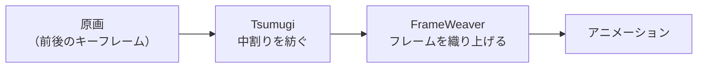

※「Tsumugi」は比較的よくある名前なので、リポジトリ名は少し具体的にして、検索で埋もれないようにする。

### 成功の段階

| 段階 | 中身 | 見立て |
|---|---|---|
| ① 評価ハーネス | 3枚組の正解データと採点の仕組みを作り、RIFEなど既存手法の失敗を数字で示せる | 十分に達成できる |
| ② 方針の実証 | 「ピクセルより面・構造の単位の方が良い」を、条件を絞った実験で数字で示せる | 達成できる可能性が高い |
| ③ 限定条件での実用 | 動きが小さい、塗り済み、などの条件下で、手直しが少なくて済む中割りが作れる | 頑張れば届く |
| ④ 全自動の実用品 | 前後関係の入れ替わりや大きな動きも含めて、現場品質で自動化 | 数ヶ月では難しい |

①と②だけでも、記事やOSSとして価値がある。

### 強みとリスク

| 強み | リスク |
|---|---|
| 自分で絵を描けて、アニメの制作工程を知っている。正解データを自分で作れ、生成結果の良し悪しを自分の目で判断できる | 仮説が多すぎる（H0〜H9）。最初は1〜2個に絞る |
| 評価ハーネスの設計や、ハーネスで補う考え方がすでに整理できている | 正解データの注釈（面や線の対応）の手間 |
| 数ヶ月前の「とりあえずRIFEを試す」とは出発点が違う | 2枚の間でパーツや線の対応を取る部分で詰まる可能性 |
| | GPUの制約（RTX 3080 / VRAM 10GB） |

### 最初の一歩

範囲を絞って始める。

- **入力**：塗り済みの原画2枚
- **出力**：真ん中の1枚（時点0.5）だけ
- **題材**：歩きの足の前後が入れ替わる場面
- **比較**：RIFE と「面の単位で対応を取る方式」
- **検証できること**：H9（基本方針）の最初の部分と、以前の失敗の原因

tcg-buylist-evalと並行すると両方止まりやすいので、どちらを先にするかを最初に決める。

---

## 目次

1. [背景：これまでの取り組み](#1-背景これまでの取り組み)
2. [入力の理解が最も上流の能力](#2-入力の理解が最も上流の能力)
3. [「理解」は理解する力 × 入力に含まれる情報](#3-理解は理解する力--入力に含まれる情報)
4. [理解を上げる4つの方法](#4-理解を上げる4つの方法)
5. [イラストの理解に言語化は必要か](#5-イラストの理解に言語化は必要か)
6. [RIFEに足りなかったもの：構造](#6-rifeに足りなかったもの構造)
7. [どの方法が一番効くか](#7-どの方法が一番効くか)
8. [人間の描き方に近づける：理解・計画・描画の3段階](#8-人間の描き方に近づける理解計画描画の3段階)
9. [調査：構造的に捉える中割りモデル](#9-調査構造的に捉える中割りモデル)
10. [【基本方針】面・構造・塊にコンテキストを載せる](#10-基本方針面構造塊にコンテキストを載せる)
11. [研究の方向性：学習する方向とハーネスで補う方向](#11-研究の方向性学習する方向とハーネスで補う方向)
12. [中割り生成の評価ハーネス](#12-中割り生成の評価ハーネス)
13. [評価ハーネスで確認するべきこと](#13-評価ハーネスで確認するべきこと)
14. [tcg-buylist-evalとの関係と進め方](#14-tcg-buylist-evalとの関係と進め方)
15. [まとめ](#15-まとめ)
16. [参考](#16-参考)

---

## 1. 背景：これまでの取り組み

| 段階 | 内容 | 結果 |
|---|---|---|
| ① RIFE | ComfyUIのRIFE VFIノードで、歩行する2枚の原画から中割りを8枚生成 | 体や髪など動きの少ない部分はきれいだが、足が溶ける・消えるなど、大きく動いて隠れる部分で破綻 |
| ② ToonCrafter | アニメ特化の拡散モデル。ピクセル補間ではなく「絵を描き直す」アプローチ | 導入を検討（RTX 3080 / VRAM 10GBでは低VRAM設定で条件付きで動作） |
| ③ 当時の結論 | **モデルを変えるより、中間の原画を1枚足す方が効果的** | 「入力を増やす」が鍵 |

### RIFEが失敗した原因（当時の考察）

- **前後関係（オクルージョン）**：原画1では右足、原画2では左足が体の後ろに隠れている。隠れた部分をどう補間するかの情報を持っていない
- **非線形な動き**：足は直線ではなく弧を描いて動くが、RIFEは2点間を最短経路で補間しようとする
- **意図的なデフォルメ**：アニメ特有の誇張や形状変化を理解できない

---

## 2. 入力の理解が最も上流の能力

エージェントのハーネス設計の議論で、LLMに必要な能力を次のように分解した。

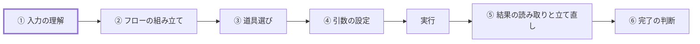

**入力の理解は一番上流**。ここで間違えると、その後のフロー・道具選び・引数がどれだけ正しくても、**間違った前提の上で正しく動くだけ** になる。誤りが下流に全部伝わる。

人間でも、頭が良い人は資料を見たり話を聞いたりした時の理解力が高く、その後のタスクを正確に実行できる可能性が高い。

---

## 3. 「理解」は理解する力 × 入力に含まれる情報

### 人間のアニメーターで考える

優秀なアニメーターでも、原画2枚だけ渡されたら次のことは分からない。

- どちらの足を前に出すのか
- どんなタイミングで動かすのか
- どんな弧を描いて動かすのか

だから現場では、**タイムシート、作画の指示、ブレイクダウンの原画** が一緒に渡される。

### 理解の失敗には2種類ある

| 種類 | 中身 | 対策 |
|---|---|---|
| **理解する力の不足** | 情報は入力にあるのに、読み取れない | モデルを変える、入力を読みやすくする |
| **情報の不足** | 意図がそもそも入力に含まれていない | 入力に情報を足す。どんなに賢いモデルでも推測しかできない |

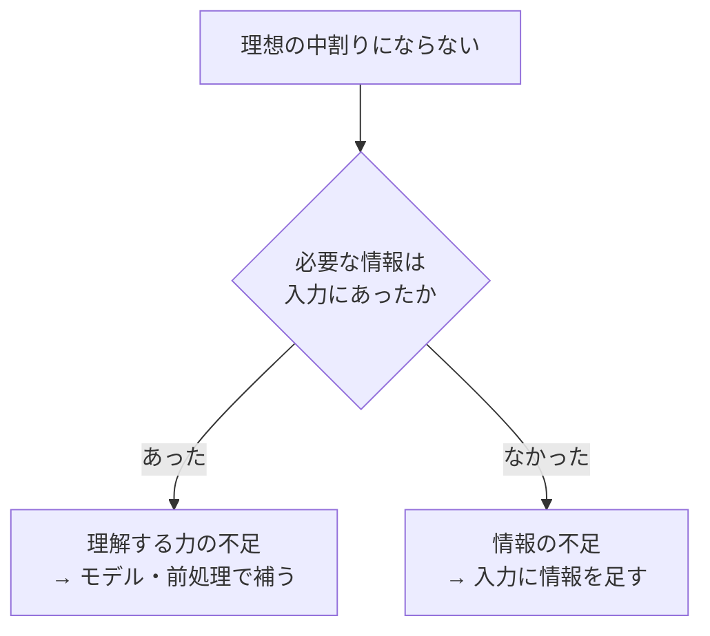

RIFEでの失敗は、モデルの能力不足に加えて、**情報の不足も大きかった** と考えられる。

---

## 4. 理解を上げる4つの方法

| # | 方法 | 中身 | 中割りでの例 |
|---|---|---|---|
| 1 | **モデル側** | 認識に強いモデルを選ぶ、その分野のデータでファインチューニングする | アニメの線画で学習したモデル（ToonCrafterなど）を使う |
| 2 | **入力を読みやすくする** | 専用の処理で前もって構造を取り出しておく。ハーネス側でLLMを使わずにできる | ポーズ推定で骨格を取り出す、線画と塗りを分ける、パーツごとに分ける |
| 3 | **情報を足す** | 意図を明示的に渡す | ブレイクダウンの原画、つめの指示、軌道線、テキストでの意図 |
| 4 | **理解を確認するステップを挟む** | 実行前に「入力をどう理解したか」を出力させ、確認する | 推定した骨格が前後の原画と整合しているかをチェックする |

---

## 5. イラストの理解に言語化は必要か

### 疑問

RIFEがイラストを読み込んで内部でテキストとして理解しているなら、実現可能性はかなり下がるのではないか。アニメーターは中割りを描く時に言語化しているだろうか。言語化する場合もあるかもしれないが、大体はイラストとして理解し、前後のフレームの動きを推測して描いている。

### 答え：モデルは内部でテキストにしていない

| モデル | 内部での扱い方 |
|---|---|
| **RIFE**（フレーム補間） | 画像の特徴から「各ピクセルがどの方向にどれだけ動いたか」（オプティカルフロー）を推定し、それに沿って画像を変形して混ぜ合わせる。最初から最後まで映像の世界の中だけで処理する |
| **ToonCrafter**（拡散モデル） | 画像を潜在空間という数値の表現に変換して処理する。テキストの指示を添えることはできるが、内部でイラストを言葉にしているわけではない |
| **マルチモーダルLLM** | 画像を文章に書き起こすのではなく、画像を言葉と同じ空間の数値に変換して扱う |

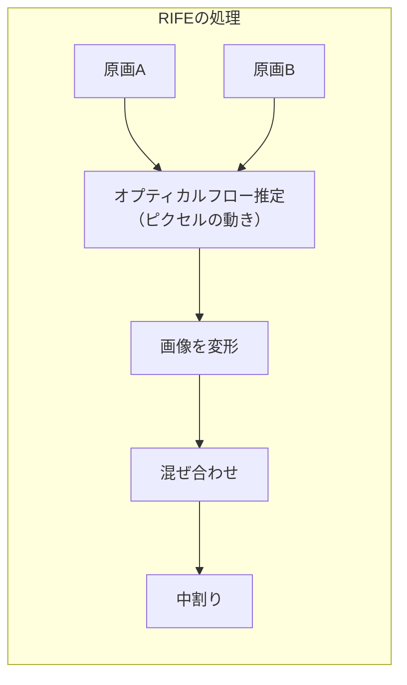

**「理解には言語化が必要」ということはない。** アニメーターが言語化せずに絵として理解している、という考えはモデルの仕組みとも合っている。

---

## 6. RIFEに足りなかったもの：構造

足りなかったのは言語化ではなく、**理解の表現が低すぎた** こと。RIFEが持っているのは「ピクセルの動き」だけで、次の構造を知らない。

- どこが足で、どこが関節か
- どちらの足が手前にあって、どちらが隠れるか（前後関係）
- 足は直線ではなく弧を描いて動く、といった動きの約束事

### 理解の表現のレベル

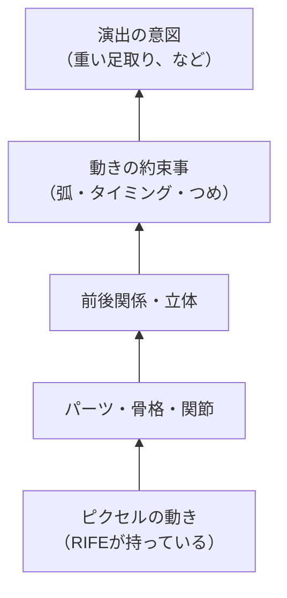

アニメーターも言葉にはしていないが、骨格、立体、前後関係、軌道といった **構造化された視覚的な理解** を持って描いている。足りないのは言葉ではなく、この構造。

### アニメの現場には、意図を言葉以外で伝える形式がすでにある

| 形式 | 伝える情報 |
|---|---|
| タイムシート | 各フレームのタイミング |
| つめの指示 | 中割りを原画のどちら寄りに描くか（動きの緩急） |
| 軌道線 | 動きがどんな弧を描くか |
| ブレイクダウンの原画 | 動きの途中の重要なポーズ |

これらは文章ではなく、**絵や記号で「どう動かすか」を伝えている**。

---

## 7. どの方法が一番効くか

### 直感的な順位（中割りの場合）

| 順位 | 方法 | 理由 |
|---|---|---|
| **1位** | **3. 情報を足す** | 2枚の原画に含まれていない意図そのものを渡すので、どんなに賢いモデルでも推測しかできない部分を埋められる |
| **2位** | **2. 入力を読みやすくする** | RIFEが持っていない構造を、言葉を使わずに外から先に取り出して渡せる |
| 3位 | 1. モデル側 | 効果はあるが、コストが大きく、情報不足は解決できない |
| 4位 | 4. 理解を確認する | 言葉で確認させるのは中割りには不向き。ただし **構造で確認する**（骨格の整合をチェックする）形なら使える |

### 2と3の組み合わせ

以前に検討した案は、まさに2と3の組み合わせ。

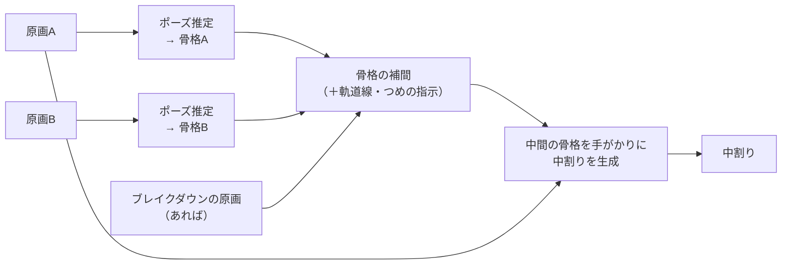

### 方針：テキストだけでなく、構造の情報を与える

言語の役割は **人間の意図を伝える窓口**。「左足から踏み出す、重い足取り」のような指示は、2枚の原画にはない情報なので役に立つ。

ただし、動きのタイミングや軌道のように、**言葉より絵や記号の方が正確に伝わる情報** も多い。中割りでは「言葉で補う」より、**アニメーターが使っている絵と記号の形式で補う** 方が筋が良い。

| 情報の渡し方 | 向いている情報 |
|---|---|
| テキスト | 演出の意図、雰囲気（「重い足取り」「急いで」） |
| 構造（骨格・パーツ） | どこがどう動くか、前後関係 |
| 記号（つめ・軌道線・タイムシート） | 動きの緩急、軌道、タイミング |
| 絵（ブレイクダウン） | 途中の重要なポーズ |

---

## 8. 人間の描き方に近づける：理解・計画・描画の3段階

### 問題意識1：RIFEは指示を理解できない

イラスト・タイムシート・構造を入力に加えても、それを理解できなければ意味がない。RIFEが受け取れるのは、基本的に **「2枚の画像」と「その間のどの時点を作るか（0〜1の値）」だけ** で、テキストの指示や骨格を理解する仕組みはない。

ただし、指示には2種類ある。

| 指示の種類 | 例 | RIFEに渡せるか |
|---|---|---|
| **決まった書式の記号** | つめの指示「原画A寄りに1/3」、タイムシート | 渡せる。プログラムで機械的に「時点 0.33 の中割りを作る」に **翻訳** できる（理解ではなく翻訳なので、LLMは不要） |
| **構造・意味を含む情報** | 骨格、軌道、前後関係、演出の意図 | 渡せない。別のモデルが必要 |

### マルチモーダルLLMの役割

- **理解する役** としては有力。意図の文章とイラストを合わせて読み、「この指示はこの足のこの動きのことだ」と結び付けるのは得意な分野
- ただし多くのマルチモーダルLLMは、画像を読めても **出力はテキスト**（Claudeもそう）
- 関節の正確な座標のような細かい位置を目で読み取るのは苦手。ここはポーズ推定のような専用の処理の方が確実
- 画像も出力できるマルチモーダルモデルも出てきているが、線の位置を細かく制御できるかは別途確かめる必要がある

→ 現実的には、**マルチモーダルLLMが理解と計画を担い、画像の生成は、骨格などの構造を条件として受け取れる生成モデルが担う** 分担になる。

### 問題意識2：ピクセルで計算するのはずれている

人間は動きの構造を推測して描く。ピクセルがいくつ動くかをいちいち計算してはいない。

最終的な出力が絵である以上、どの方法でも最後はピクセルになる（人間の脳も神経細胞のレベルでは膨大な計算をしているが、本人は意識していない）。問題は「ピクセルを計算していること」ではなく、**何を単位に動きを考えているか**。

| | 動きを考える単位 | 起きること |
|---|---|---|
| RIFE | ピクセル（各点がどれだけ動いたか） | 足を「足」として動かさず、足の色の点の集まりを動かすので、隠れたり形が変わったりすると破綻する |
| 人間のアニメーター | 骨格、パーツ、線、軌道 | 構造として動かしてから線を引く |

### 3段階のフロー

アニメーターの作業を分解すると、**理解 → 計画 → 描画** の3段階になる。**ピクセルで考えるのは描画の最後だけにして、理解と計画は構造の単位で行う。**

| 段階 | 人間がやっていること | 担い手の候補 | 成果物 |
|---|---|---|---|
| **① 理解** | 原画と指示を見て、何がどう動くかを把握する | マルチモーダルLLM、ポーズ推定、パーツ分割 | 前後の原画の骨格、パーツ、前後関係 |
| **② 計画** | 中間のポーズ、軌道、つめを決める | プログラム（骨格を弧に沿って補間、タイムシートを数値に変換） | 中間の骨格、生成する時点 |
| **③ 描画** | 決めた構造に沿って線を引く | 構造を条件にした生成モデル | 中割りの画像 |

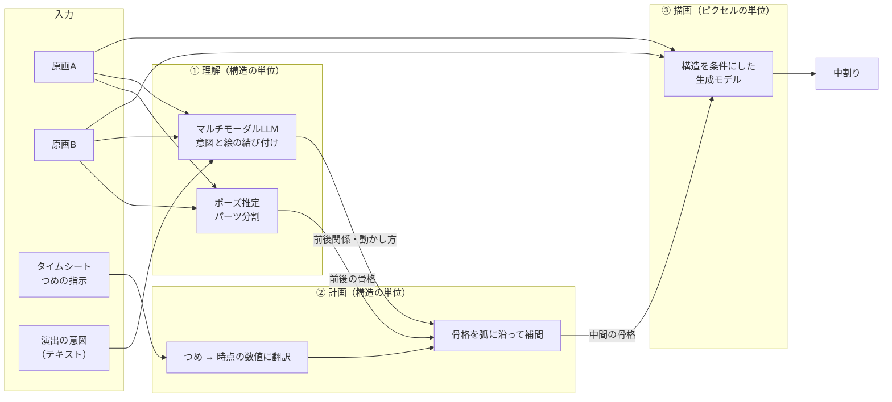

### さらに人間に近いアプローチ：線を単位にする

線画を「点と線のつながり」として扱い、前後の原画で線の対応を取って動かす研究もある。ピクセルではなく **線を単位** にしているので、アニメーターの考え方にかなり近い。

| 単位 | 方式 | 人間との近さ |
|---|---|---|
| ピクセル | RIFE（フレーム補間） | 遠い |
| 潜在表現（絵全体） | ToonCrafter（拡散モデル） | 中間 |
| 骨格 → 絵 | 骨格を補間して、それを条件に生成 | 近い |
| 線 | 線の対応を取って動かす | かなり近い |

### Claudeにできること・できないこと（参考）

| できる | できない・苦手 |
|---|---|
| 原画を見て、どちらの足が手前か、どこで前後関係が入れ替わるかを言葉にする（①理解の一部） | 手描きの線画をアニメーターの質で描き直す |
| ブレイクダウンやつめの提案を言葉や簡単な図で示す（②計画の一部） | 関節の正確な座標を目で読み取る |
| ベクター（SVG）の原画で線の対応が取れていれば、点を補間するプログラムを書く | 作業環境でToonCrafterのような生成モデルを動かす（GPUがない） |

---

## 9. 調査：構造的に捉える中割りモデル

### 問題意識

オプティカルフローはピクセルの推定なので、**アニメーションのコンテキストが失われる**。ピクセルはあくまで線を描く時に使うもので、絵を構造的に捉える、**人間が絵を描く方法に近い方法** で推定する必要があるのではないか。

### 研究の世界も同じ結論に向かっている

- 画像全体を対応付けて変形させる従来のフレーム補間は、線画の中割りには向かず、細かな線の構造を壊すぼやけが出やすい（AnimeInbetの論文）
- ピクセル単位の手法は、まばらで簡潔な線画には適さず、強い破綻を生みやすく実用にならない（同上）

RIFEで足が溶けたのは、まさにこの現象。

### ただし構造だけでも足りない

- 人の動きの補間の研究では、**骨格による誘導は構造の手がかりにはなるが、形の細部が欠けて体型や見た目が不自然になる** と報告されている（PoseFuse3D-KI）
- 2025年のスケッチアニメーションの総説では、最近のシステムは **領域・線・ピクセルという複数の階層での対応付け** に、**骨格の誘導** と **生成モデルの事前知識** を組み合わせているとまとめられている

人間も「骨格で動きを考える」と「線を丁寧に引く」の両方をやっている。**構造で考えて、ピクセル（線の質）は最後に整える** という8章の3段階の整理と合っている。

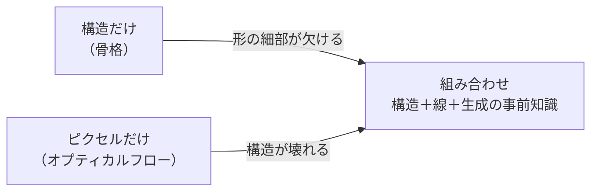

### アプローチ別のモデル

| # | アプローチ | 代表的な手法 | 中身 | 公開状況 |
|---|---|---|---|---|
| 1 | **線を点と線のグラフとして扱う** | AnimeInbet（ICCV 2023） | ラスターの線画を端点のグラフに変換し、対応する頂点を見つけて動かす。線のつながり方が変わらないので、細かい線の構造が保たれる。RIFEなどを上回り、特に動きが大きいほど差が開いた | コード・データ公開 |
| 2 | **線（ストローク）単位で対応を取る** | Joint Stroke Tracing and Correspondence（TOG 2024） | 連続するラスターの原画と、最初の1枚のベクター画像を手がかりに、残りの原画を線の1対1の対応付きでベクター化する | コード公開 |
| | | **LayerInbetween（SIGGRAPH 2026）** | 自動でレイヤー分けを行い、**隠れる線の対応付けと中割りでの前後関係** を解決する。今回の歩行の例（足が隠れる問題）に最も関係が深い | コード公開 |
| 3 | **骨格で動かす** | Skeleton-Driven Inbetweening of Bitmap Character Drawings | アニメーターが原画の間で骨格を動かして動きを制御する。骨格と2枚のラスター原画以外にはほとんど注釈が要らない。3Dの回転への対応などが課題 | コード公開（GitHub） |
| 4 | **軌道や下描きで生成モデルを導く** | **Framer（ICLR 2025）** | 開始・終了フレームに加えて、特徴点の軌道を指定して途中の動きを制御する。軌道を自動推定する「オートパイロット」モードもある。アニメの補間にも対応 | コード・デモ公開 |
| | | Deep Sketch-guided Cartoon Video Inbetweening | 2枚の原画に加えて、アーティストが描いたラフな下描きを手がかりに生成する。「決定的な補間結果より、描くことで制御したい」という問題意識 | 論文 |
| 5 | **立体（奥行き）で捉える** | AniDepth | 塗りから奥行きを推定し、その奥行きを補間して、それを手がかりに線画と塗りを生成する | 論文 |
| 参考 | 特徴点の変形 | Thin-Plate Spline-based Interpolation（AAAI 2025） | 特徴点の対応から、薄板スプラインで大きな変形を表現する | コード公開 |

### 動きを考える単位の比較（更新版）

| 単位 | 方式 | 代表例 | 人間との近さ |
|---|---|---|---|
| ピクセル | フレーム補間 | RIFE | 遠い |
| 潜在表現（絵全体） | 拡散モデル | ToonCrafter | 中間 |
| 特徴点・軌道 → 絵 | 軌道を条件にした生成 | Framer | やや近い |
| 骨格 → 絵 | 骨格を動かして変形 | Skeleton-Driven | 近い |
| 線（頂点・ストローク） | 線の対応を取って動かす | AnimeInbet、LayerInbetween | かなり近い |

### 3段階のフローへの当てはめ

| 段階 | 対応する技術 |
|---|---|
| ① 理解 | 線のベクター化と対応付け（Joint Stroke Tracing）、前後関係の判定（LayerInbetween）、ポーズ推定、奥行き推定（AniDepth） |
| ② 計画 | 骨格のアニメーション（Skeleton-Driven）、特徴点の軌道（Framer） |
| ③ 描画 | 頂点の再配置（AnimeInbet）、軌道を条件にした生成（Framer） |

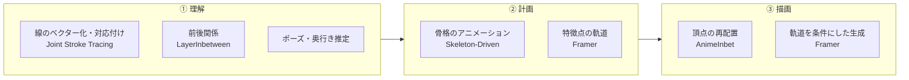

### 注意点

- **学習データと手描きの差**：AnimeInbetの学習データ（MixamoLine240）は3Dモデルをアニメ調にレンダリングして作ったもの。手描きの原画とは差があるかもしれない
- **入力の前提**：線の単位の手法は、きれいな線画やベクター化を前提にするものが多い。ラフな原画や塗りのある絵での性能は個別に確認が必要
- **動作環境**：各手法がRTX 3080（VRAM 10GB）で動くかは個別に確認が必要
- **索引**：この分野の論文やツールは、GitHubの「Awesome-2D-Animation」にアプローチ別にまとまっている

---

## 10. 【基本方針】面・構造・塊にコンテキストを載せる

> **この研究の中核となる方針**
>
> ピクセル（点）単位で絵を捉えるのは、情報を落としすぎている。
> 少なくとも **線** として、できれば **面** として、さらに **構造・塊** として捉え、
> **それぞれの単位にコンテキスト（意味・前後関係・動きの意図）を載せる仕組み** を作る。
> 人間のアニメーターも、ピクセル単位で捉えることは少なく、面・構造・塊で考えて描いている。

### 10.1 そもそも「ピクセルの移動」とは何か

画像は細かいマス目（ピクセル）が並んだもので、各マスには色が1つ入っているだけ。**マス目そのものは動かない**。動いているように見えるのは、「この色の模様が、次の絵ではどこに現れたか」。

**オプティカルフロー** は、原画Aの各ピクセルについて「これと同じ見た目の場所は、原画Bのどこにあるか」を探し、その移動量を矢印（右に10、下に2、など）として記録したもの。中割りを作る時は、各ピクセルの色を矢印の半分だけ動かし、原画B側からも同じことをして、2枚を混ぜ合わせる。

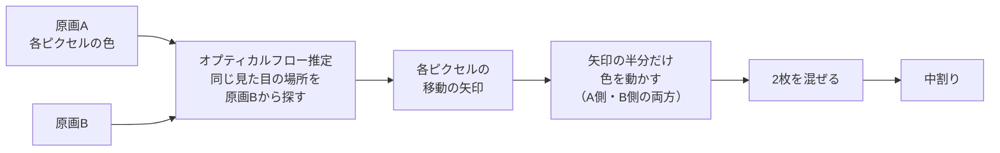

### 10.2 オプティカルフローは「線」としてすら認識していない

- RIFEのようなニューラルネットを使う手法は、各ピクセルの周りの小さな範囲を見て、「縁がある」「角がある」程度の **局所的な模様** はつかんでいる
- しかし「この黒い点の並びは1本の線で、それは左足の輪郭だ」という **まとまり** としては扱っていない
- しかもRIFEは主に実写の動画で学習しているので、アニメのパーツという単位をそもそも知らない

### 10.3 線画でピクセル単位が失敗する理由

| 理由 | 中身 |
|---|---|
| 見た目が似すぎている | 線画はほとんどが白い背景と黒い細い線。黒い点はどれも同じに見えるので、どの線のどの点が対応するか見た目だけで決められず、別の線と取り違える |
| 白い部分に手がかりがない | 白い背景や塗りの広い面はどこも同じ色なので、どちらに動いたか推定できない |
| 隠れると行き先がない | 原画Bで足が体の後ろに隠れると、原画Aの足の点に対応する場所がない。行き先がないまま両側から混ぜるので、**足が半透明になって溶ける**（ゾンビの歩行で起きた現象） |
| まっすぐにしか動かない | 矢印は始点と終点を結ぶ直線なので、弧を描く動きを表現できない |

オプティカルフローは「足」や「線」という単位を知らず、**「黒い点がどこに行ったか」だけを見ている**。アニメーターが「この線は左足の輪郭で、膝を軸に弧を描いて動き、途中で体の後ろに隠れる」と理解するのとは、考えている単位がまったく違う。

### 10.4 表現の階層

| 階層 | 単位 | 載せられるコンテキスト | 動きのルールの書きやすさ |
|---|---|---|---|
| 点 | ピクセル | 色だけ | 書けない |
| 線 | ストローク | 線のつながり、強弱 | 低い |
| 面 | 閉じた領域（塗り） | 何の面か（肌・服・髪） | 中程度 |
| 塊 | パーツ | 名前（左足）、前後関係（手前か奥か） | 高い |
| 構造 | 骨格・立体 | 関節の位置、回転の軸、奥行き | 高い |
| 意味 | 動作 | 歩く、重い足取り、弧を描く | 最も高い |

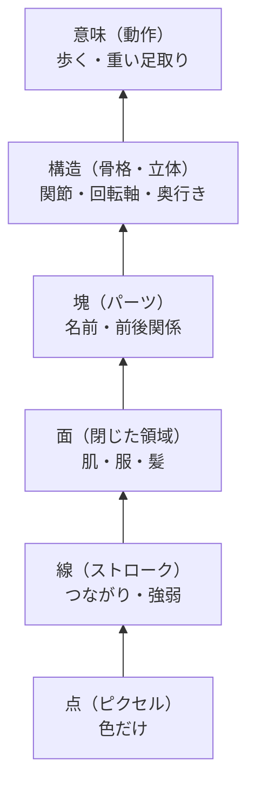

**上の階層ほど、動きのルールを書きやすくなる。** 「左足のパーツを、膝を軸に弧を描いて動かし、途中で胴体の後ろに回す」という指示は、塊と構造の階層でないと書けない。

### 10.5 アニメの制作工程はすでにこの階層を持っている

| 階層 | 制作工程での対応 |
|---|---|
| 線 | 原画・動画の線 |
| **面** | **彩色**：線で閉じた領域ごとに色指定で塗り分ける。面の単位が最初から決まっていて、**色指定表には「この色は肌、この色は服」という意味が付いている** |
| 塊 | 撮影：セルやレイヤーが分かれている |

特に **面** は、アニメの彩色の仕組みのおかげで、意味（コンテキスト）を載せやすい単位になっている。

### 10.6 研究もこの階層を1つずつ使っている

| 階層 | 研究の例 |
|---|---|
| 面 | AnimeInterp：塗りの領域ごとに対応を取る |
| 線 | AnimeInbet、Joint Stroke Tracing |
| 塊 | LayerInbetween：自動でレイヤーに分けて前後関係を扱う |
| 構造 | Skeleton-Driven（骨格）、AniDepth（奥行き） |

9章で見た総説の「領域・線・ピクセルという複数の階層で対応を取る」という流れは、この方針と同じ方向。

### 10.7 コンテキストを載せる仕組み：入れ子のデータ構造

原画を次のような入れ子のデータとして表す。

```
キャラクター
 └ パーツ（左足）      ← 前後関係、回転の軸、動きの意図
    └ 面（ズボンの領域）  ← 色指定の意味
       └ 線（輪郭のストローク）  ← つながり、強弱
          └ 点
```

| 階層 | 持たせる情報の例 |
|---|---|
| キャラクター | 動作（歩く）、演出の意図（重い足取り） |
| パーツ | 名前、前後関係の順位、回転の軸（関節）、軌道 |
| 面 | 色指定（肌・服・髪）、どのパーツに属するか |
| 線 | ストロークの形、強弱、どの面の境界か |
| 点 | 色 |

### 10.8 3段階のフロー（8章）との対応

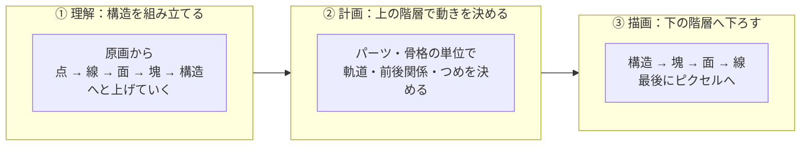

- **① 理解**：原画からこの構造を下から上へ組み立てる
- **② 計画**：パーツや骨格の単位で動きを決める
- **③ 描画**：上の階層から線、最後にピクセルへと下ろしていく

### 10.9 注意点

**一番下の階層も捨てられない**

アニメーターも、動きは塊で考えるが、最後は線の強弱やかすれまで丁寧に描く。ピクセルや線の階層は「**動きを考える単位**」としては不向きでも、「**仕上がりの質を決める単位**」としては必要。

| | 動きを考える単位として | 仕上がりの質を決める単位として |
|---|---|---|
| 点・線 | 不向き | 必要 |
| 面・塊・構造 | 適している | 不向き |

**構造を組み立てるのが一番難しい**

| 作業 | 難しさ |
|---|---|
| 塗り済みの絵から面を取り出す | 比較的簡単（閉じた領域を塗りつぶすだけ） |
| 面をパーツにまとめる | 難しい |
| パーツに名前を付ける | 難しい |
| 2枚の原画の間でパーツや線の対応を取る | 最も難しい |

上に行くほど難しくなる。これはまさに「入力の理解」の段階。

### 10.10 進め方：構造が安く手に入る所から始める

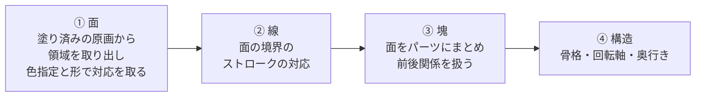

塗り済みの原画を使えば、面の単位と、色指定による意味（肌・服・髪）がほぼ無料で手に入る。そこから線、パーツ、構造へと階層を上げていく。

### 10.11 評価：階層ごとに理解の正しさを測る

| 階層 | 測ること | 必要な正解データ |
|---|---|---|
| 面 | 面の対応の正解率（原画Aのこの面は、原画Bのどの面か） | 面の対応の注釈 |
| 線 | 線の対応の正解率 | ストロークの対応の注釈 |
| 塊 | パーツの分け方の正しさ、前後関係の正解率 | パーツと前後関係の注釈 |
| 構造 | 関節の位置の誤差 | 骨格の注釈 |

どの階層の理解がボトルネックかが分かる。13章の仮説に、この方針の検証を加える（H9）。

---

## 11. 研究の方向性：学習する方向とハーネスで補う方向

### 学習する方向（学術研究の主流）

9章で挙げた手法の多くは、新しいモデルを学習するか、既存のモデルをファインチューニングしている。

| 手法 | 学習の内容 |
|---|---|
| AnimeInbet | 線画のデータセット（MixamoLine240）を自作して学習 |
| Framer | 動画生成モデル（Stable Video Diffusion）をファインチューニングし、軌道を制御する部分を追加で学習 |
| LayerInbetween | 前後関係を含む1万7千組以上の合成データで学習 |

論文として新しさを示しやすいのは新しいモデルなので、学術研究ではこちらが多くなる。

### ハーネスで補う方向（学習済みモデルの組み合わせ）

学習済みのモデルを組み合わせて、仕組みで補う研究もある。

| 手法 | 組み合わせ方 |
|---|---|
| AniDepth | 奥行き推定（Depth Anything V2）→ 動画拡散モデルで奥行きを補間 → そのオプティカルフローで線画を変形 → 拡散モデルで仕上げ。既存の部品を順番につないだパイプライン |
| Skeleton-Driven | 骨格に基づく変形で原画を同じポーズに揃え、最適化と深層学習で混ぜ合わせる。骨格・変形・合成という段階に分けた仕組み |
| Generative Inbetweening | 学習済みの「画像から動画を作るモデル」を、一から学習し直さずに中割りに適応させる |

**ComfyUIのワークフロー自体が、画像生成モデルのハーネス**。ノードをつないで前処理・生成・後処理を組み立てるのは、エージェントのハーネスと同じ構造。

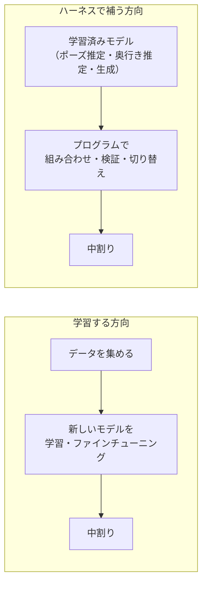

### エージェントのハーネスの考え方をそのまま移せる

| エージェントのハーネス | 中割りのハーネス |
|---|---|
| 工程を分ける | 理解・計画・描画の3段階に分ける（8章） |
| 道具を渡す | ポーズ推定、線画抽出、奥行き推定などの学習済みモデル |
| 手順をコードで固定する | 骨格を弧に沿って補間し、タイムシートを数値に翻訳するのはプログラム |
| 出力を検証してリトライ | 生成した絵の骨格が計画と合っているか、手足の数、線の途切れをチェックし、ダメなら別のシードや強い条件でやり直す |
| 適応型ハーネス | 骨格が重なる（前後関係が入れ替わる）ことを検出したら、別の手法に切り替える、またはブレイクダウンの原画を人に求める |

### アニメーターの割り方をハーネスの手順にする

アニメーターは、まず真ん中の中割りを描き、次にその間を割る、という順番で描く。これをハーネスで再現すれば、一度に8枚作らせるより破綻が少なくなる可能性がある。

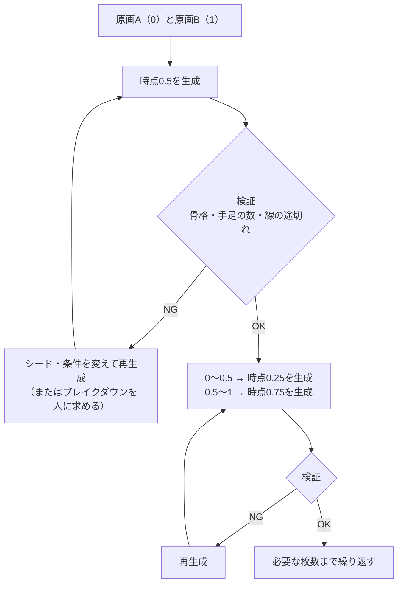

### 適応型ハーネスの例（ルールベース）

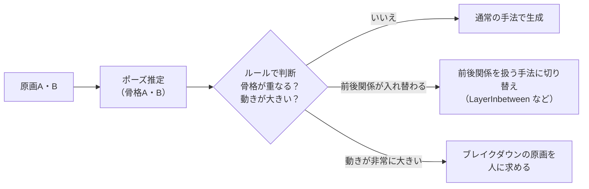

判断はすべてプログラムで書けるので、エージェントの研究で決めた **「ハーネス側にLLMを使わず、ルールで判断する」方針がそのまま使える**。

### この方向が研究に合っている理由

- 学習用のGPUや大量のデータがなくても始められる（RTX 3080の環境とも相性が良い）
- ルールベースの判断方針がそのまま使える
- 学術研究ではモデルを作る方向が主流なので、**「既存モデル＋ハーネスでどこまで行けるかを評価で示す」は、比較的競合の少ない切り口**

### ハーネスの天井

エージェントの時と同じで、ハーネスにも天井がある。**生成モデルが骨格などの条件を守って描けなければ、どれだけ計画を良くしても限界がある**。

- 13章の「計画に正解を与えた場合の描画の結果」と「計画への忠実さ」を測れば、天井の位置が分かる
- 天井が低ければ、そこで初めてファインチューニングを検討する（エージェントの時と同じ順番）

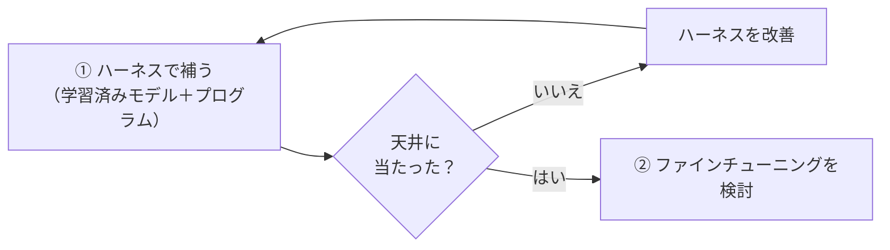

---

## 12. 中割り生成の評価ハーネス

### 中割りの評価が難しい点

買取表なら「カード名が一致しているか」で採点できるが、中割りは **正解の絵が1つに決まらない**。同じ原画2枚からでも、アニメーターによって描き方は少しずつ違う。評価の設計が一番の山場。

### 正解データの作り方：3枚組

アニメーターが描いた連続する3枚を用意し、真ん中を隠して生成させ、本物と比べる。

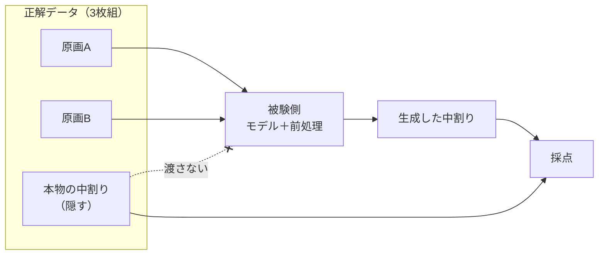

| データの出どころ | 特徴 |
|---|---|
| 公開データセット（ATD-12Kなど） | アニメの補間研究で使われている。量がある |
| 自分で描いた作画 | 自分の理想と比べる評価にできる |

### 採点の方法

1つの指標では足りないので、複数を組み合わせる。

| 種類 | 中身 | 向いている所 | 弱点 |
|---|---|---|---|
| ピクセルの一致 | 本物とどれだけ同じ色か | 計算が簡単 | 線画は少しずれるだけで大きく減点される |
| 線の距離 | 生成した線と本物の線がどれだけ近いか | 線画に向いている | 線の太さや質は見ない |
| **構造の一致** | 生成した絵と本物の絵でポーズ推定を行い、関節の位置を比べる | 足が消えた、前後が入れ替わった、を検出できる | ポーズ推定自体が間違えることがある |
| 破綻のチェック | 手足の数が合っているか、パーツが溶けていないか | 致命的な失敗を拾える | 自動化に工夫が必要 |
| 人の評価 | 2つの結果を並べてどちらが良いか選ぶ | 最終的な品質に一番近い | 手間がかかる |

**構造の一致** は「構造の情報を与える」という方針と表裏一体。**構造を入力として与えて、出力の構造で採点する** という一貫した設計にできる。

**指標についての注意（調査より）**：線画の中割りの評価ではChamfer Distance（線の距離）がよく使われるが、**この値が良くても線が途切れた中割りが生成されることがある** と指摘されている（Thin-Plate Spline-based Interpolationの論文）。線の距離だけに頼らず、破綻のチェック（線の途切れの検出を含む）を必ず併用する。

### 比べる条件：情報の量を段階的に増やす

| 条件 | 与える入力 |
|---|---|
| L0 | 原画2枚だけ |
| L1 | ＋テキストの意図（「左足から踏み出す、重い足取り」など） |
| L2 | ＋骨格（ポーズ推定の結果や、補間したスケルトン） |
| L3 | ＋ブレイクダウンの原画 |
| L4 | ＋つめの指示や軌道線 |

これをRIFE、ToonCrafterなど複数のモデルで回す。

| モデル | 動きを考える単位 | L0 | L1 | L2 | L3 | L4 |
|---|---|---|---|---|---|---|
| RIFE（基準） | ピクセル | | | | | |
| ToonCrafter（基準） | 潜在表現 | | | | | |
| Framer | 特徴点・軌道 | | | | | |
| Skeleton-Driven | 骨格 | | | | | |
| AnimeInbet | 線（頂点） | | | | | |

※ モデルによって受け取れる入力が違う（RIFEはテキストや骨格を受け取れない、など）ので、受け取れない条件は空欄になる。空欄の多さ自体も「そのモデルにどれだけ情報を渡せるか」の比較になる。

この表を埋めると次のことが分かる。

- **縦に比べる**：モデルを変える効果
- **横に比べる**：情報を足す効果
- **L1とL2の差**：「テキストで足すより、構造で足す方が効く」という直感の検証

### 失敗の分類

| 失敗 | 例 |
|---|---|
| パーツが溶ける | 足の形が崩れて混ざる |
| パーツが消える | 隠れていた足が中間で消える |
| 前後関係の破綻 | 手前と奥の足が入れ替わる |
| 軌道の誤り | 弧ではなく直線で動く |
| 線の崩れ | 線がぼやける、二重になる、太さが乱れる |
| 線の途切れ | 本来つながっている線が切れる |

---

## 13. 評価ハーネスで確認するべきこと

### 確認したい仮説

| # | 仮説 | 比べる条件 |
|---|---|---|
| H0 | ピクセル単位より、構造（線・骨格・軌道）の単位で動きを考えるモデルの方が良い | RIFE と AnimeInbet・Skeleton-Driven・Framer（9章） |
| H1 | 情報を足すほど中割りは良くなる | L0〜L4（12章） |
| H2 | テキストで足すより、構造で足す方が効く | L1 と L2 |
| H3 | 3段階に分けた方が、一括で生成するより良い | 一括型 と 3段階型 |
| H4 | つめの指示を時点の数値に翻訳するだけでも、RIFEのタイミングは改善する | RIFE（時点固定）と RIFE（つめを翻訳） |
| H5 | 理解の段階は、マルチモーダルLLMよりポーズ推定の方が正確（または組み合わせが最良） | ①の担い手を変える |
| H6 | 足が隠れるような前後関係の入れ替わりは、前後関係を明示的に扱う手法（LayerInbetweenなど）でないと解決できない | 前後関係の入れ替わりがある3枚組だけを集めて比較 |
| H7 | アニメーターの割り方（真ん中から順に割る）をハーネスで再現すると、一度に全枚数を生成するより破綻が少ない | 一括生成 と 階層的な生成（11章） |
| H8 | 学習済みモデル＋ハーネス（検証・リトライ・ルールベースの切り替え）で、ファインチューニングした専用モデルに近い品質が出せる | ハーネスあり と ハーネスなし、専用モデル |
| **H9** | **動きを考える単位の階層を上げるほど（点 → 線 → 面 → 塊 → 構造）、中割りは良くなる**（基本方針の検証） | 同じ生成モデルで、対応を取る階層だけを変えて比較（10章） |

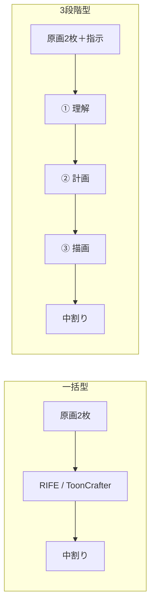

### 段階ごとに採点する

エージェントの評価で話した「ステップごとの成果物で採点する」考え方を、中割りにもそのまま当てはめる。段階ごとに採点すれば、失敗が **理解・計画・描画のどこで起きたか** を切り分けられる。

| 段階 | 確認すること | 採点の方法 | 必要な正解データ |
|---|---|---|---|
| **① 理解** | 前後の原画の骨格は正しく取れたか | 関節の位置の誤差 | 原画A・Bの骨格の注釈 |
| | 前後関係（どちらの足が手前か）を正しく判定できたか | 正解ラベルとの一致 | 前後関係のラベル |
| | （LLMを使う場合）意図と絵を正しく結び付けたか | 理解の出力と正解の注釈の一致 | 動きの説明の注釈 |
| **② 計画** | 中間の骨格は本物に近いか | 本物の中割りから取った骨格との関節誤差 | 本物の中割りの骨格 |
| | 軌道は弧を描いているか | 関節の軌跡の曲がり具合 | 本物の軌跡 |
| | つめの指示通りの時点になっているか | 指示した時点との差 | タイムシート・つめの指示 |
| **③ 描画** | 計画した骨格の通りに描けたか（計画への忠実さ） | 生成した絵から取った骨格と、計画の骨格の誤差 | なし（②の成果物と比べる） |
| | 本物の中割りに近いか | 線の距離、構造の一致 | 本物の中割り |
| | 破綻していないか | パーツの数、溶け・消えの検出 | なし |
| | 絵として良いか | 人の評価（並べて選ぶ） | なし |

③の「計画への忠実さ」は正解データがなくても測れる。**描画のモデルが構造の条件をどれだけ守れるか** を単独で評価できる。

### 理想の入力を与えて上限を測る

段階ごとの限界を知るには、**前の段階に正解を与えた場合** の性能を測る。

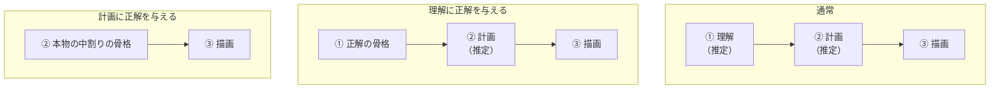

| 比較 | 分かること |
|---|---|
| 通常 と 理解に正解を与えた場合 | 理解の誤りが、最終結果をどれだけ悪くしているか |
| 理解に正解 と 計画に正解を与えた場合 | 計画の誤りの影響 |
| 計画に正解を与えた場合の結果 | **描画の上限**。これが低ければ、どれだけ理解と計画を良くしても限界がある |

これはエージェントの評価で話したアブレーションと同じ考え方で、「どの段階に力を入れるべきか」を数字で決められる。

### ログに残すもの

| 項目 | 中身 |
|---|---|
| 入力条件 | L0〜L4のどれか、使ったモデル、理解・計画の担い手 |
| ①の成果物 | 前後の骨格（JSON）、前後関係の判定、LLMの理解の出力 |
| ②の成果物 | 中間の骨格（JSON）、生成する時点 |
| ③の成果物 | 生成した画像 |
| スコア | 段階ごとの採点結果、最終的な指標 |
| コスト | 処理時間、GPUメモリ、（API利用時は）料金 |

エージェントのログと同じく、**各段階の成果物を必ず残す**。最終的な絵だけでは、どこで間違えたかが分からない。

### 注意点

- **正解データの手間**：段階ごとに採点するには、骨格や前後関係の注釈が必要。まずは少数（数十組）を自分で注釈して始める
- **採点の道具自体の検証**：ポーズ推定は実写向けに作られたものが多く、アニメ絵では精度が落ちる可能性がある。採点に使う前に、手で付けた骨格と比べて **ものさし自体が信頼できるか** を確かめる
- **LLMの位置付け**：ここでマルチモーダルLLMを使う場合は、ハーネスの判断役ではなく、①理解の **主役のモデル** として扱う。適応型ハーネスの研究で決めた「ハーネス側にLLMを使わない」方針とは区別して、ログでも担い手を明記する

---

## 14. tcg-buylist-evalとの関係と進め方

### 骨組みは共通、違うのは採点の中身

| 要素 | tcg-buylist-eval | 中割り生成 |
|---|---|---|
| タスクの定義 | 買取表画像 → カード一覧（JSON） | 原画2枚（＋追加情報） → 中割り画像 |
| 被験側 | LLM＋ハーネス | 生成モデル＋前処理 |
| 正解データ | カード名・価格 | 本物の中割り |
| 採点 | 一致率（正解が1つ） | 複数の指標の組み合わせ（正解が1つに決まらない） |
| ログ | トレース（JSONL） | 入力条件・生成結果・各指標のスコア |

中割りは「正解が1つに決まらない」性質のタスクなので、**評価ハーネスを汎用的に作れているかの試金石** になる。

### 注意点

- Inspect AIはLLMの評価を中心に作られているので、画像生成モデルを載せるには工夫が必要かもしれない。実際に作る前に確認する
- ローカル環境（RTX 3080 / VRAM 10GB）では、ToonCrafterは低VRAM設定・低解像度での実行になる。AWS上で動かす場合はGPUインスタンスの選定が必要

### 進め方

```mermaid
flowchart LR
    A["① tcg-buylist-evalを作る<br/>タスクを差し替えられる設計にする"] --> B["② 中割りを<br/>2つ目のタスクとして追加"]
    B --> C["③ 情報量（L0〜L4）×<br/>モデルで比較"]
    C --> D["汎用評価ハーネスの証明"]
```

中割りがスムーズに載れば、汎用評価ハーネスという目標を達成できたことの証明にもなる。

---

## 15. まとめ

- 入力の理解は最も上流の能力で、ここで間違えると下流は全部ずれる
- 「理解」は **理解する力 × 入力に含まれる情報**。中割りの失敗は、モデルの力不足に加えて情報の不足も大きかった
- モデルはイラストを内部でテキストにしていない。**理解に言語化は必要ない**
- RIFEに足りなかったのは言葉ではなく **構造**（骨格、前後関係、動きの約束事）
- 中割りで一番効きそうなのは **情報を足す**、次に **入力を読みやすくする（構造を取り出す）**
- 方針：**テキストだけでなく、構造の情報を与える**。アニメの現場の形式（タイムシート、つめ、軌道線、ブレイクダウン）は、意図を言葉以外で伝える優れた形式
- RIFEは指示を理解できない。ただし、つめやタイムシートのような決まった書式の記号は、プログラムで時点の数値に **翻訳** して渡せる
- マルチモーダルLLMは理解の役として有力だが、出力はテキスト。描画は構造を条件にした生成モデルが担う
- 問題は「ピクセルを計算していること」ではなく **「何を単位に動きを考えているか」**。人間に近づけるなら **理解 → 計画 → 描画** の3段階に分け、理解と計画は構造の単位で行う
- **【基本方針】ピクセル（点）単位で絵を捉えるのは情報を落としすぎ。線、できれば面、さらに構造・塊として捉え、それぞれの単位にコンテキストを載せる仕組みを作る**。アニメの彩色は面ごとに色指定の意味を持つので、面から始めると構造が安く手に入る
- 研究の世界でも、ピクセル単位のフレーム補間は線画の中割りに向かないとされている。一方で、構造だけでも形の細部が欠けるため、**構造・線・生成の事前知識の組み合わせ** が主流になりつつある
- 構造的に捉えるモデルとして、線のグラフ（AnimeInbet）、線の対応（Joint Stroke Tracing、LayerInbetween）、骨格（Skeleton-Driven）、軌道（Framer）、奥行き（AniDepth）がある。足が隠れる問題には、前後関係を扱うLayerInbetweenが最も関係が深い
- 学術研究ではモデルを学習する方向が主流だが、学習済みモデルを組み合わせる **ハーネスで補う方向** もある（AniDepth、Skeleton-Driven など）。ComfyUIのワークフロー自体が画像生成モデルのハーネス
- エージェントのハーネスの考え方（工程分割・検証とリトライ・ルールベースの適応）はそのまま中割りに移せる。**アニメーターの割り方（真ん中から順に割る）をハーネスの手順にする** のは有望
- 研究の方向性は **ハーネスで補う方向を主軸** にし、天井に当たったらファインチューニングを検討する
- 評価は3枚組の正解データで行い、**構造の一致** を中心に複数の指標を組み合わせる。線の距離だけでは線の途切れを見逃すので、破綻のチェックを併用する
- 評価では **段階ごとに採点** し、前の段階に正解を与えた場合と比べて、どの段階がボトルネックかを数字で示す
- 情報量（L0〜L4）× モデルの表で、「モデルを変える効果」と「情報を足す効果」を比べる
- tcg-buylist-evalをタスク差し替え可能に作り、2つ目のタスクとして中割りを載せる

---

## 16. 参考

### 線・ストローク単位
- [Deep Geometrized Cartoon Line Inbetweening（AnimeInbet, ICCV 2023）](https://openaccess.thecvf.com/content/ICCV2023/html/Siyao_Deep_Geometrized_Cartoon_Line_Inbetweening_ICCV_2023_paper.html)
- [Joint Stroke Tracing and Correspondence for 2D Animation（TOG 2024）](https://dl.acm.org/doi/10.1145/3649890)
- [LayerInbetween: Occlusion-Aware Stroke Correspondence and Inbetweening with Automatic Layering（SIGGRAPH 2026）](https://dl.acm.org/doi/10.1145/3811364)
- [Thin-Plate Spline-based Interpolation for Animation Line Inbetweening（AAAI 2025）](https://export.arxiv.org/pdf/2408.09131)

### 骨格・軌道・下描き・奥行き
- [Skeleton-Driven Inbetweening of Bitmap Character Drawings（GitHub）](https://github.com/kbrodt/inbetweening)
- [Framer: Interactive Frame Interpolation（ICLR 2025）](https://proceedings.iclr.cc/paper_files/paper/2025/hash/801ec05b0aae9fcd2ef35c168bd538e0-Abstract-Conference.html)
- [Deep Sketch-guided Cartoon Video Inbetweening](https://arxiv.org/pdf/2008.04149)
- [AniDepth: Anime In-between Diffusion using Depth-guided Warped Line-art](https://dl.acm.org/doi/10.1145/3721239.3734091)
- [Generative Inbetweening: Adapting Image-to-Video Models for Keyframe Interpolation](https://arxiv.org/pdf/2408.15239)
- [Controllable Human-centric Keyframe Interpolation with Generative Prior（PoseFuse3D-KI）](https://arxiv.org/html/2506.03119v1)

### 総説・索引
- [Sketch Animation: State-of-the-art Report](https://arxiv.org/html/2510.10218v1)
- [Awesome-2D-Animation（GitHub）](https://github.com/MarkMoHR/Awesome-2D-Animation)
